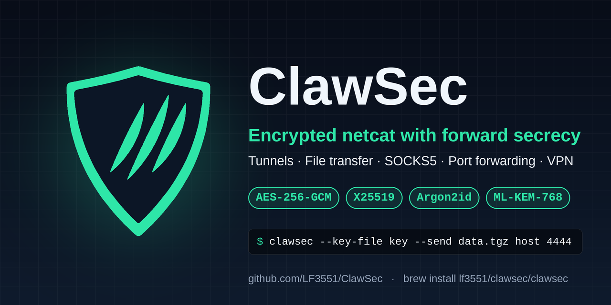

<p align="center">
  
</p>

<p align="center">
  <a href="https://github.com/LF3551/ClawSec/actions/workflows/build.yml"></a>
  <a href="https://github.com/LF3551/ClawSec/actions/workflows/codeql.yml"></a>
  <a href="https://scorecard.dev/viewer/?uri=github.com/LF3551/ClawSec"></a>
  <a href="https://github.com/LF3551/ClawSec/releases/latest"></a>
  <a href="LICENSE"></a>
  <br />
  <a href="https://github.com/LF3551/homebrew-clawsec"></a>
  <a href="https://github.com/LF3551/ClawSec/pkgs/container/clawsec"></a>
  <a href="https://aur.archlinux.org/packages/clawsec"></a>
  
</p>

**ClawSec** is an **encrypted netcat alternative** (a modern descendant of
Cryptcat) for **secure tunnels without certificates**: pipe data, transfer
files with resume and SHA-256 verification, forward ports, run a SOCKS5 proxy
or a point-to-point **TUN VPN** — all protected by AES-256-GCM and a
**SPAKE2 password-authenticated key exchange** (RFC 9382): forward secrecy, no
offline password guessing, optional post-quantum ML-KEM-768.

```bash
brew install lf3551/clawsec/clawsec            # or a static binary / Docker, see below
clawsec -l -p 4444 --key-file key --recv ./in   # receiver
clawsec --key-file key --send backup.tgz host 4444
```

> **Scope.** ClawSec is a community project that has not been externally
> audited. For production remote access prefer OpenSSH or WireGuard; see
> [SECURITY.md](SECURITY.md) for the threat model and known limitations.

## Features

| Area | What you get |
|------|--------------|
| **Crypto** | SPAKE2 PAKE (RFC 9382) with transcript-bound mutual key confirmation and forward secrecy, Argon2id, AES-256-GCM records with authenticated headers, HKDF directional keys, optional `--pq` hybrid with ML-KEM-768 (OpenSSL ≥ 3.5), optional `--tofu` server identity (Ed25519, `known_hosts`) |
| **Modes** | stdin/stdout stream, chat (`-c`), file transfer with resume + SHA-256 (`--send`/`--recv`), port forwarding (`-L`, `--mux`), reverse tunnel (`-R`), SOCKS5 (`--socks`), TUN VPN (`--tun`, `--tun-udp`, `--default-route`, `--masquerade`), opt-in remote program (`-e`), UDP (`-u`) |
| **Operations** | `-K` multi-client with `--max-clients`, `--max-per-ip`, `--auth-fail-limit`, `--handshake-timeout`, `--persistent` reconnect, `-z` compression, `-P` progress, `-V` verification, IPv4/IPv6, shell completions, man page |
| **Traffic shaping** | `--obfs http\|tls`, `--fingerprint`, `--ech`, `--fallback`, `--pad`, `--jitter` (see their limits below) |
| **Recon** | `--scan` (Linux, as root: pipelined SYN half-open scan for IPv4/IPv6 at `--scan-rate` probes/s with open/closed/filtered detection; otherwise parallel connect scan; randomised order), `-b` banner grabbing |
| **Footprint** | ~135 KB dynamically linked; release binaries for Linux are fully static (~5.6 MB, no runtime dependencies); Docker image ~18 MB |

Unlike `ncat --ssl` or `socat openssl`, which use TLS certificates, ClawSec
authenticates both ends with a shared password.

## Security Features

- **AES-256-GCM**: Authenticated encryption; the frame header (sequence number, length, version) is authenticated too
- **SPAKE2 (RFC 9382)**: password-authenticated key exchange — an eavesdropper or man-in-the-middle cannot test password guesses offline; every attempt costs a connection. Forward secrecy from fresh scalars per session; verified against the RFC test vectors
- **Transcript binding**: both confirmation MACs (and the `--tofu` signature) cover the whole handshake — versions, options, identity key, ML-KEM data
- **Argon2id**: memory-hard password scalar via libargon2, computed once per process
- **Key updates (`--rekey 30m|2h|100000r`)**: each direction ratchets its stream key (HKDF, like TLS 1.3 KeyUpdate) and wipes the old one: a key that leaks later does not decrypt earlier traffic, and long sessions have no record limit
- **Guessing limits**: with `-K`, `--auth-fail-limit` blocks an address after repeated wrong passwords, `--max-per-ip` caps concurrent handlers per address
- **Directional keys**: HKDF-SHA256 derives separate client→server and server→client keys (TCP and UDP), so frames cannot be reflected
- **Version and option check**: wrong passwords, incompatible versions and different `--tofu`/`--pq` settings are reported during the handshake, with a clear error and exit status 1
- **Replay Protection**: Strict sequence numbers on TCP; sliding anti-replay windows for UDP (`-u`: 64, `--tun-udp`: 256)
- **Bounded decryption**: Plaintext is released only after tag verification and never beyond the caller's buffer
- **Protocol Versioning**: Wire protocol v4 (ClawSec 4.x); peers on a different version are rejected with a clear error on both ends
- **Memory Safety**: Key material wiped with `OPENSSL_cleanse`; CI runs ASan/UBSan/LeakSanitizer, `-Werror` and libFuzzer

### Traffic shaping (anti-DPI) — what it does and does not do

These options change how the traffic *looks*; none of them adds secrecy
beyond the inner encryption, and none makes ClawSec undetectable.

| Flag | What it does | Limits |
|------|--------------|--------|
| `--obfs tls` | Runs the session inside a real TLS 1.3 connection | The server presents a **self-signed** certificate with a made-up CDN name; anyone who connects can see that it is not that site |
| `--obfs http` | Wraps every message in an HTTP POST | Trivially recognisable by a protocol-aware observer |
| `--fingerprint chrome\|firefox\|safari` | Sets cipher suites, groups, signature algorithms, ALPN (and ALPS for Chrome) like the browser | OpenSSL cannot reproduce extension order, GREASE or other details: the ClientHello **approximates** a browser, it does not match its JA3/JA4 exactly |
| `--ech` | Adds a GREASE Encrypted Client Hello extension | The visible SNI (a fake CDN name) is still sent in clear; nothing is actually hidden by it |
| `--fallback host:port` | After the TLS handshake, clients that do not send the ClawSec knock are proxied to another service | Probers still see ClawSec's self-signed certificate; unlike REALITY it does not borrow a real site's TLS identity |
| `--pad` | Every encrypted record is padded to a multiple of 1400 bytes (in every mode: stream, `-L`, `--mux`, `--socks`, `-R`, `-u`, `--tun`, `--tun-udp`, file transfer); stream-like modes send 1400-byte records | Hides message sizes, not timing or total volume; both ends need `--pad` and 4.2+ (negotiated, mismatch is an explicit error); with `--tun` the interface MTU becomes 1392 |
| `--jitter N` | Random 0–N ms delay before each message | Adds latency; does not hide traffic volume |

## Quick Start

### Automatic Installation

```bash
# Clone repository
git clone https://github.com/LF3551/ClawSec.git
cd ClawSec

# Install build dependencies, build, optionally install to /usr/local/bin
./scripts/install.sh
```

### Homebrew (macOS, Linux)

```bash
brew install lf3551/clawsec/clawsec
```

### Prebuilt binaries

Every [release](https://github.com/LF3551/ClawSec/releases) has tested binaries
(`clawsec-<version>-<os>-<arch>.tar.gz`, verify with `SHA256SUMS`):
Linux x86_64 and arm64 are fully static (no runtime dependencies, any
distribution); macOS arm64 and x86_64 use Homebrew's `openssl@3` and `argon2`
(`brew install openssl@3 argon2`, or use the tap above).

**Verifying a download** (releases from 4.3.0 on are signed in CI with
Sigstore; nothing to trust but GitHub's OIDC identity of the release workflow):

```bash
# checksums, signed keylessly by the release workflow
cosign verify-blob SHA256SUMS --bundle SHA256SUMS.sigstore.json \
  --certificate-identity-regexp '^https://github.com/LF3551/ClawSec/\.github/workflows/release\.yml@' \
  --certificate-oidc-issuer https://token.actions.githubusercontent.com
sha256sum --ignore-missing -c SHA256SUMS

# SLSA build provenance of an archive (which workflow and commit built it)
gh attestation verify clawsec-<version>-linux-x86_64.tar.gz -R LF3551/ClawSec

# Docker image signature (SBOM and provenance are attached to the image)
cosign verify ghcr.io/lf3551/clawsec:<version> \
  --certificate-identity-regexp '^https://github.com/LF3551/ClawSec/\.github/workflows/docker-publish\.yml@' \
  --certificate-oidc-issuer https://token.actions.githubusercontent.com
```

### Manual Build

```bash
cd src
make linux    # Linux with system OpenSSL
make macos    # macOS with Homebrew OpenSSL
make alpine   # Alpine Linux (Docker)
make freebsd  # FreeBSD
make netbsd   # NetBSD
```

### Docker

```bash
# Build image
docker build -t clawsec .

# Run server (the image has no default password; pass it via the environment)
docker run -e CLAWSEC_PASSWORD="$(openssl rand -base64 24)" -p 8888:8888 clawsec

# Or use docker compose
CLAWSEC_PASSWORD="$(openssl rand -base64 24)" docker compose up

# Prebuilt multi-arch images: ghcr.io/lf3551/clawsec, lf3551/clawsec
```

### Basic Usage

ClawSec supports three main modes: **Chat Mode**, **Reverse Shell Mode**, and **File Transfer Mode**.

#### 1. Chat Mode (Encrypted Communication)

Secure encrypted chat with session fingerprints, read receipts, inline file sharing, and slash commands.

**Server:**
```bash
./clawsec -l -p 8888 -k "TestPass123" -c -n "Alice"
```

**Client:**
```bash
./clawsec -k "TestPass123" -c -n "Bob" server-ip 8888
```

**Features:**
- 🔐 **Session fingerprint**: emoji + hex fingerprint shown at connect — verify both sides match to confirm no MITM
- 📛 **Custom nicknames** (`-n`): display names instead of Server/Client
- ✓✓ **Read receipts**: automatic delivery confirmations
- 📎 **Inline file sharing**: `/file path` sends small files (up to ~8 KB) through the chat; use `--send`/`--recv` for larger files
- 🏓 **Encrypted ping**: `/ping` measures RTT through the encrypted tunnel
- Slash commands: `/file`, `/ping`, `/clear`, `/whoami`, `/help`
- Colored timestamps: green for local, cyan for remote
- Session duration shown on disconnect
- All communication encrypted with AES-256-GCM + PFS

#### 2. Reverse Shell Mode (Encrypted Remote Access)

Get encrypted command-line access to a remote machine.

> `-e` hands a program (here a shell) to anyone who knows the password, so it
> is **not built by default** since 3.0. Build it in explicitly:
> `make linux DFLAGS=-DGAPING_SECURITY_HOLE` (or `macos`, `freebsd`, ...).

**Server (target machine):**
```bash
cd ~/ClawSec/src
make linux DFLAGS=-DGAPING_SECURITY_HOLE
./clawsec -l -p 8888 -k "TestPass123" -e /bin/bash
```

**Client (your machine):**
```bash
./clawsec -k "TestPass123" server-ip 8888
```

**Features:**
- Full encrypted shell access to target
- Run commands: `ls`, `cd`, `cat`, `ps`, `whoami`, `pwd`, etc.
- All traffic encrypted end-to-end
- Clean output without formatting

**Note**: Interactive programs (`nano`, `vim`, `top`) are now supported with PTY (pseudo-terminal). Use Ctrl+C to terminate programs, and `exit` or Ctrl+D to close the shell.

#### 3. File Transfer Mode (Secure File Transmission)

Transfer files with compression, progress bar, and SHA-256 verification.

**Server (receiving machine):**
```bash
./clawsec -v -l -p 8888 -k "FilePass123" > received_file.py
```

**Client (sending machine):**
```bash
./clawsec -v -k "FilePass123" server-ip 8888 < file_to_send.py
```

**With compression, progress & verification:**
```bash
# Server
./clawsec -l -p 8888 -k "FilePass123" -z -P -V > received.tar.gz

# Client
./clawsec -k "FilePass123" -z -P -V server-ip 8888 < archive.tar.gz
```

**Features:**
- `-z` zlib compression: reduces bandwidth 3-5x for text files
- `-P` built-in progress bar with speed and bytes (no external `pv` needed)
- `-V` SHA-256 end-to-end verification: hash sent after transfer, receiver verifies
- Automatic connection close after transfer
- Transfer statistics: `[Transfer complete] Sent/Received X bytes`
- Files transferred with full AES-256-GCM encryption
- Supports any file type (text, binary, archives)

**Advanced Examples:**

```bash
# Transfer archive
tar -czf - /path/to/directory | ./clawsec -k "pass" server 9999
./clawsec -l -p 9999 -k "pass" | tar -xzf -

# Transfer with progress (requires pv)
pv largefile.iso | ./clawsec -k "pass" server 7777
./clawsec -l -p 7777 -k "pass" > largefile.iso
```

## Requirements

- **OpenSSL 3.x**: AES-GCM, P-256 (SPAKE2), HKDF, TLS camouflage (`--pq` needs OpenSSL ≥ 3.5)
- **libargon2**: Argon2id password hashing (same result on every platform)
- **zlib**: `-z` compression
- **GCC/G++ or Clang**: C11 / C++11
- **POSIX System**: Linux, BSD, macOS

### Install dependencies

```bash
# macOS
brew install openssl@3 argon2

# Debian/Ubuntu
sudo apt-get install libssl-dev libargon2-dev zlib1g-dev build-essential

# Fedora/RHEL (EPEL)
sudo dnf install openssl-devel libargon2-devel zlib-devel gcc gcc-c++ make

# Arch
sudo pacman -S openssl argon2 zlib

# Alpine
apk add openssl-dev argon2-dev zlib-dev gcc g++ make musl-dev linux-headers
```

## Usage

```
Usage: clawsec [options] hostname port
       clawsec -l -p port [options]

Password (one of; precedence top to bottom):
  -k password       On the command line (visible in ps/history; discouraged)
  --key-file file   First line of a file (mode 0600)
  CLAWSEC_PASSWORD  Environment variable
  (none)            Prompt on the terminal, no echo

Connection:
  -l                Listen mode for inbound connections
  -p port           Local port number
  -K                Keep-open: one handler process per client
  --max-clients n   With -K: concurrent handlers (default 16)
  --control path    With -K: status socket (read with clawsec --status path)
  --config file     Read options from a file (key = value)
  --max-per-ip n    With -K: concurrent handlers per address, IPv6 per /64
                    (default 8, 0 = unlimited)
  --users file      Server: per-user passwords instead of one shared password
  --add-user name   With --users: add a user or change its password
  --set-user name   With --users: change a user's options (--user-option)
  --del-user name   With --users: remove a user
  --user-option o   ip=A.B.C.D | socks-allow=CIDR;CIDR | disabled | none
  --user name       Client: log in as name (server runs --users)
  --rekey when      Update the stream keys every 30m, 2h or 100000r records
                    (both ends, 4.3+; not with -u)
  --auth-fail-limit n  With -K: refuse an address for 10 min after n wrong
                    passwords within 10 min (default 5, 0 = off)
  --handshake-timeout s  Abort session setup after s seconds (default 15, 0 = off)

Options:
  -c                Chat mode with timestamps and colors
  -v                Verbose mode
  -z                Compress data with zlib before encryption
  -P                Show transfer progress bar
  -V                SHA-256 end-to-end file verification
  -n name           Chat nickname (default: Server/Client)
  -L host:port      Port forwarding (encrypted tunnel)
  --obfs http       Traffic obfuscation (anti-DPI)
  --obfs tls        Run inside TLS 1.3 (self-signed certificate)
  --ech             Add a GREASE Encrypted Client Hello extension
  --mux             Multiplex streams over one tunnel (with -L): up to 255
                    concurrent streams, flow control, half-close
  --fallback h:p    Proxy clients without the ClawSec knock to h:p
  --tofu            Trust On First Use (SSH-like server identity)
  --pq              Post-quantum hybrid (SPAKE2 + ML-KEM-768)
  --fingerprint p   Browser-like TLS ClientHello (chrome, firefox, safari)
  --scan range      Port scan, randomised order (1-1024, 22-443, all)
  --scan-rate pps   SYN scan probes per second (default 1000)
  -b                Banner grab (show service version on open ports)
  --socks [h:]port  SOCKS5 proxy through encrypted tunnel (client listens on
                    127.0.0.1 unless an address is given; no proxy auth)
  --socks-allow l   SOCKS server: allow only destinations in CIDR list l
                    (default: all except loopback, link-local/metadata, multicast)
  --pad             Pad every record to 1400-byte units (all modes; both ends)
  --jitter ms       Random delay 0-N ms between packets
  -w secs           Timeout for connects
  --version         Print version and wire protocol
  -e prog           Execute program per connection (only in builds made with
                    DFLAGS=-DGAPING_SECURITY_HOLE)
```

## Examples

### Chat Mode
```bash
# Server: Listen for encrypted chat
./clawsec -l -p 8888 -k "TestPass123" -c -n "Alice"

# Client: Connect to server for chat
./clawsec -k "TestPass123" -c -n "Bob" server-ip 8888
```

Both sides see:
```
╔══════════════════════════════════════╗
║    🔐 ClawSec Encrypted Chat         ║
╚══════════════════════════════════════╝
  🔐 Session: a3f2-81bc-44de-9f71  🔒🌟💎🚀🍀🌸
  Verify this matches on both sides to confirm no MITM.
  Type /help for commands

  📛 Peer identified as: Bob
[10:30:15 Alice] Hello!
  ✓✓ delivered
[10:30:18 Bob] Hi! Check /ping
  ✓✓ delivered
  🏓 Pong: 12 ms RTT
```

### Reverse Shell Mode
```bash
# Server: Provide encrypted shell access (binary built with DFLAGS=-DGAPING_SECURITY_HOLE)
./clawsec -l -p 8888 -k "TestPass123" -e /bin/bash

# Client: Connect and execute commands
./clawsec -k "TestPass123" server-ip 8888
ls
pwd
whoami
```

### File Transfer Mode
```bash
# Server: Receive file with statistics
./clawsec -v -l -p 8888 -k "FilePass123" > received.py

# Client: Send file
./clawsec -v -k "FilePass123" server-ip 8888 < file.py

# With compression + progress + verification
./clawsec -z -P -V -l -p 8888 -k "FilePass123" > received.iso
./clawsec -z -P -V -k "FilePass123" server-ip 8888 < file.iso
```

Output:
```
[Sent] 42.3 MB  (12.5 MB/s)
[Transfer complete] Sent 88000000→42300000 bytes (compressed)
[Verify] SHA-256 OK: ba7816bf8f01cfea...
```

### Advanced Examples
```bash
# Transfer directory as archive
tar -czf - /data | ./clawsec -k "pass" server 9999
./clawsec -l -p 9999 -k "pass" | tar -xzf -

# Verbose debug mode
./clawsec -vv -l -p 8080 -k "debug"
```

### Port Scan
```bash
# Scan common ports (1-1024)
./clawsec --scan 1-1024 target.com

# Scan ALL ports (65535) — takes ~2 seconds on localhost, ~60s remote
./clawsec --scan all target.com

# Custom range, slower and randomised (--jitter between probes)
./clawsec --scan 1-65535 --jitter 50 target.com

# Force IPv4/IPv6
./clawsec --scan 1-1024 -4 target.com
./clawsec --scan 1-1024 -6 target.com

# Verbose — shows scan method
./clawsec --scan 22-443 -v target.com
```

### Banner Grabbing
```bash
# Scan with service version detection
./clawsec --scan 1-1024 -b target.com

# Example output:
#    22/tcp  open
#        └─ SSH-2.0-OpenSSH_8.9p1 Ubuntu-3ubuntu0.6
#    80/tcp  open
#        └─ HTTP/1.1 200 OK
#   443/tcp  open
#        └─ (TLS — no plaintext banner)
```

### SOCKS5 Proxy (Encrypted Tunnel)
```bash
# Server: accept connections and proxy outbound
./clawsec -l -k "strongpass" -p 9999 --socks 0

# Client: open local SOCKS5 proxy on 127.0.0.1:1080
./clawsec -k "strongpass" --socks 1080 server.com 9999

# The proxy has no authentication, so it listens on loopback by default.
# Share it with your LAN only deliberately: --socks 0.0.0.0:1080

# Server-side destination policy: by default every destination is allowed
# EXCEPT the server itself (127.0.0.0/8, ::1), link-local / cloud metadata
# (169.254.169.254, fd00:ec2::254, ...), multicast and reserved ranges.
# Restrict it to an explicit list (replaces the defaults):
./clawsec -l -k "strongpass" -p 9999 --socks 0 --socks-allow 10.0.0.0/8,192.168.1.0/24

# Now use any SOCKS5-aware application:
curl --proxy socks5://127.0.0.1:1080 https://ifconfig.me
# Firefox: Settings → Network → SOCKS5 → 127.0.0.1:1080
# ssh: ssh -o ProxyCommand='nc -x 127.0.0.1:1080 %h %p' user@target

# Combine with other features:
./clawsec -k "pass" --socks 1080 --pq --tofu --obfs tls server.com 9999
```

Since 4.1 every SOCKS connection is a separate multiplexed stream: a browser
can load a page over dozens of parallel connections, a slow download does not
hold up other connections, and half-closed connections work. Both ends need
4.1 or later; with an older server the client falls back to one connection at
a time and prints a warning.

### Encrypted File Transfer (Resume + SHA-256)
```bash
# Receiver: listen and save files to ./incoming/
./clawsec -l -k "secretkey" -p 4444 --recv ./incoming

# Sender: encrypt and transfer a file
./clawsec -k "secretkey" --send backup.tar.gz remote.host 4444

# Features:
# - AES-256-GCM encrypted transfer
# - SHA-256 end-to-end verification
# - Automatic resume on interrupted transfers (data is kept in
#   <name>.clawsec-part and moved into place only after SHA-256 matches)
# - Progress bar with speed display
# - Receiver never writes through symlinks/hard links, never creates hidden
#   files or paths outside the target directory

# Combine with post-quantum crypto and obfuscation:
./clawsec -k "pass" --send secret.pdf --pq --obfs tls server.com 4444
```

### Reverse Tunnel (-R)
```bash
# Expose internal service (e.g. web app on :3000) to remote server
# Server: listen on 9999, open port 8080 for reverse connections.
# The server listens exactly on the given address: 0.0.0.0 = public,
# 127.0.0.1 = only reachable from the server itself.
./clawsec -l -k "strongpass" -p 9999 -R 0.0.0.0:8080 -v

# Client (behind NAT/firewall): connect and forward to local :3000
./clawsec -k "strongpass" -R 127.0.0.1:3000 -v server.com 9999

# Now anyone can access server.com:8080 → tunneled to client's localhost:3000
# Works like SSH -R but with AES-256-GCM encryption, no certificates needed

# Combine with traffic shaping:
./clawsec -k "pass" -R 127.0.0.1:22 --pq --obfs tls --persistent server.com 443
```

### Persistent Auto-Reconnect
```bash
# Client auto-reconnects on disconnect (exponential backoff 1s→60s)
./clawsec -k "pass" --persistent -R 127.0.0.1:22 server.com 9999

# Keeps tunnel alive through network interruptions
# Works with any mode: -L, -R, --socks, chat, etc.
./clawsec -k "pass" --persistent --socks 1080 server.com 443

# Ideal for:
# - Unstable networks (mobile, satellite)
# - Long-running tunnels that must survive reboots
# - Unattended links that must come back after outages
```

### TUN VPN Mode (--tun)

> **Requirements:**
> - Root/sudo (for TUN device creation)
> - Server must have a **public (white) IP** or a forwarded port on the router.
>   Behind CGNAT/double NAT the server cannot accept incoming connections —
>   use a VPS ($3/mo) as relay or ask your ISP for a public IP.
> - Dynamic public IP works fine — consider DDNS (e.g. noip.com) so clients
>   can connect by hostname instead of a changing address.

```bash
# Point-to-point encrypted VPN with one command

# Server (public IP or port-forwarded):
sudo ./clawsec -l -k "VpnSecret123" -p 9000 --tun 10.0.0.1/24 --masquerade

# Client — ALL traffic through VPN (like a real VPN service):
sudo ./clawsec -k "VpnSecret123" server.com 9000 --tun 10.0.0.2/24 --default-route

# UDP data channel — avoids TCP-over-TCP meltdown, lower latency:
sudo ./clawsec -l -k "VpnSecret123" -p 9000 --tun 10.0.0.1/24 --masquerade --tun-udp
sudo ./clawsec -k "VpnSecret123" server.com 9000 --tun 10.0.0.2/24 --default-route --tun-udp

# That's it! Your entire internet now goes through the server.
# curl ifconfig.me will show the server's IP, not yours.

# With --masquerade, server NATs client traffic to internet (exit node)
# Without --default-route, only VPN subnet traffic goes through tunnel
# With --default-route, ALL traffic goes through VPN (full tunnel mode)

# Combine with PQ crypto for quantum-resistant VPN:
sudo ./clawsec -k "pass" --tun 10.0.0.2/24 --default-route --pq --persistent server.com 9000

# Dynamic IP? Use DDNS hostname:
sudo ./clawsec -k "pass" --tun 10.0.0.2/24 --persistent myvpn.ddns.net 9000

# No public IP at all? Use a $3 VPS as relay:
# VPS:    ./clawsec -l -k "pass" -p 9000 --tun 10.0.0.1/24 --masquerade
# Client: sudo ./clawsec -k "pass" vps.example.com 9000 --tun 10.0.0.2/24
```

**Many clients, IPv6 (4.2+).** With `-K` the server becomes a hub: one TUN
device, one process per client, addresses handed out by the server:

```bash
# Server: IPv4 /24 and an IPv6 ULA prefix, NAT for both, per-user passwords
sudo clawsec -l -p 9000 -K --tun 10.8.0.1/24 --tun6 fd00:c1a5::1/64 --masquerade \
     --users /etc/clawsec/users

# Clients: ask the server for an address (10.8.0.2 + fd00:c1a5::2, ...)
sudo clawsec --user alice --tun auto --default-route vpn.example.com 9000
sudo clawsec --user bob   --tun 10.8.0.20/24 vpn.example.com 9000   # fixed address
```

- Each client may only send from its own addresses (anything else is dropped
  and logged); packets are routed to clients by destination address.
- Client-to-client traffic passes the server's kernel: it works when IP
  forwarding is on (`--masquerade` enables it) and can be filtered there.
- `--default-route` with IPv6 adds `::/1` and `8000::/1` through the tunnel;
  removed again on exit.
- ClawSec 4.1 clients still work (the hub learns their address from the
  first packet).
- `--tun-udp` works with `-K` too (4.3+): the hub runs every client's UDP data
  channel on the server port, with its own replay window per client; clients
  that cannot use UDP stay on the TCP channel.

### Password Requirements

SPAKE2 rules out offline guessing, but each connection is still one online
guess. Use a random password (`openssl rand -base64 24`, ≥ 128 bits) or a long
passphrase; never default, example or dictionary passwords.

### Passing the password

`-k <password>` works, but anything on the command line is visible to other
local users (`ps`, `/proc/<pid>/cmdline`) and ends up in shell history.
ClawSec overwrites it in its own argv right away, but prefer:

```bash
# 1. A key file (first line; keep it mode 0600)
openssl rand -base64 24 > ~/.clawsec-key && chmod 600 ~/.clawsec-key
clawsec -l -p 1234 --key-file ~/.clawsec-key

# 2. The CLAWSEC_PASSWORD environment variable (removed from the environment
#    after reading, so -e programs and child processes do not inherit it)
CLAWSEC_PASSWORD="$(cat ~/.clawsec-key)" clawsec server.example.com 1234

# 3. No password option at all: ClawSec prompts on the terminal (no echo)
clawsec server.example.com 1234
```

Precedence: `-k` > `--key-file` > `CLAWSEC_PASSWORD` > prompt.
Docker, docker-compose, Kubernetes and systemd examples in this repository
use the environment variable or a systemd credential.

### Per-user passwords

Instead of one shared password, a server can give every user their own:

```bash
# Server admin: add users (asks for the password twice; file mode 0600)
clawsec --users /etc/clawsec/users --add-user alice
clawsec --users /etc/clawsec/users --add-user bob

# Server: no shared password needed
clawsec -l -p 9000 -K --users /etc/clawsec/users

# Client
clawsec --user alice server.example.com 9000      # password prompt / --key-file / CLAWSEC_PASSWORD
```

- The users file stores `w = Argon2id(password, user-specific salt)`, not passwords;
  equal passwords give different lines. SPAKE2 is a balanced PAKE, so a line still
  lets someone log in *as that user*: protect the file like a private key.
- The file is read on every connection: add, change or delete users without a restart.
- Per-user options: a fixed VPN address, the user's own SOCKS destinations, or a
  disabled account:

  ```bash
  clawsec --users /etc/clawsec/users --add-user carol --user-option ip=10.8.0.10
  clawsec --users /etc/clawsec/users --set-user bob --user-option socks-allow=10.0.0.0/8
  clawsec --users /etc/clawsec/users --set-user bob --user-option disabled   # lock
  clawsec --users /etc/clawsec/users --set-user bob --user-option none       # clear
  clawsec --users /etc/clawsec/users --del-user bob
  ```
- An unknown user fails exactly like a wrong password (no user enumeration).
- The server logs `user 'alice' logged in`; `-e` programs get `CLAWSEC_USER`.
- Not available with `-u`.

### Server configuration file and status

Long server command lines can live in a file; options given on the command
line come after it and win. A password cannot be put there (use `key-file`).

```ini
# /etc/clawsec/server.conf
listen
port = 9000
keep-open
tun = 10.8.0.1/24
tun6 = fd00:c1a5::1/64
masquerade
users = /etc/clawsec/users
max-clients = 64
control = /run/clawsec.sock
```

```bash
sudo clawsec --config /etc/clawsec/server.conf
sudo clawsec --status /run/clawsec.sock
# ClawSec 4.3.0, pid 1234, up 2h05m, 2 of 64 sessions
# PID      PEER              USER    AGE
# 4321     203.0.113.7       alice   1h12m
# VPN SLOT   PID    USER   IPV4        IPV6           RX (pkts/B)   TX (pkts/B)
#     0      4321   alice  10.8.0.10   fd00:c1a5::a   48211/31M     52940/58M
```

Keys are the long option names (`tun`, `users`, `max-per-ip`, …) or `listen`,
`port`, `keep-open`, `udp`, `ipv4`, `ipv6`, `verbose`, `timeout`, `forward`,
`reverse`, … for the short ones; flags are `key` or `key = yes|no`. The status
socket is created with mode 0600 and only reports sessions (no secrets).

### Operational Security

1. Use a random password (`openssl rand -base64 24`)
2. Never put passwords in scripts or command lines; use `--key-file` or `CLAWSEC_PASSWORD`
3. Share passwords through secure channels only
4. Expose servers with `-K` and keep the defaults `--max-clients 16`,
   `--max-per-ip 8`, `--auth-fail-limit 5` and `--handshake-timeout 15` (or
   lower): idle clients cannot pile up and password guessing is throttled
   (`authentication failure from <address>` is logged; a block is always logged)

## Cryptographic Specifications

| Component | Algorithm | Parameters |
|-----------|-----------|------------|
| Cipher | AES-256 | 256-bit key |
| Mode | GCM | AEAD with authentication |
| Key exchange | SPAKE2, RFC 9382 | P-256, SHA-256, HKDF, HMAC; fresh scalars per session |
| Password scalar | Argon2id (libargon2) | t=3, m=19 MiB, p=1 |
| Post-quantum (`--pq`) | ML-KEM-768 (FIPS 203) | hybrid with SPAKE2 |
| Traffic keys | HKDF-SHA256 | separate keys per direction, per channel (TCP / UDP) |
| IV | CSPRNG | 96 bits (12 bytes) |
| Auth Tag | GMAC | 128 bits (16 bytes), covers header (AAD) + ciphertext |

### Protocol Format

```
[MAGIC:4][VERSION:2][FLAGS:2][SEQ:4][LENGTH:4][IV:12][TAG:16][CIPHERTEXT]
```

- Magic number: `0x434C4157` ("CLAW")
- Version: `0x0004` (protocol v4, ClawSec 4.x — not compatible with ClawSec ≤ 3.1.0)
- Sequence number: strictly consecutive per direction; a session never reuses one
- The 16-byte header is GCM associated data: altering sequence, length, version or flags invalidates the tag

### Session Handshake

```
Client ──TCP connect──▶ Server
Client ◀── hello "CS"+v4+flags, pB = y·P + w·N  [, identity key] [, ML-KEM pk] ── Server
Client ── hello "CS"+v4+flags, pA = x·P + w·M  [, ML-KEM ciphertext] ──▶ Server
       [Both: K, TT, Ke as in RFC 9382; AAD = SHA-256(message 1 ‖ message 2)]
Client ◀── cB = HMAC(KcB, TT)  [, Ed25519 signature over TT and AAD] ── Server
Client ── cA = HMAC(KcA, TT) ──▶ Server
       [Both: session = HKDF(Ke [‖ ML-KEM secret], "ClawSec v4 session" ‖ AAD)]
Client ◀──encrypted messages──▶ Server
```

w = Argon2id(password). A peer on another protocol version or with other
`--tofu`/`--pq` settings is reported at the hello; a wrong password or any
change to the handshake fails the confirmation, on both ends. A failed attempt
gives an attacker nothing to test further password guesses against offline.

Perfect Forward Secrecy: even if the password is later compromised,
previously recorded sessions cannot be decrypted.

See [SECURITY.md](SECURITY.md) for detailed cryptographic documentation.

## Comparison

| Feature | ClawSec | Original Cryptcat | Netcat |
|---------|---------|-------------------|--------|
| Encryption | AES-256-GCM | Twofish (deprecated) | None |
| Authentication | GCM Tag | None | None |
| Key Derivation | Argon2id + HKDF | Direct key | N/A |
| Memory Safety | Secure wiping | No | N/A |
| Protocol Version | Yes | No | N/A |

## Testing

```bash
cd src

# Unit/integration tests (140 tests)
make linux && make test          # macOS: make macos && make test-macos

# Same tests under AddressSanitizer + UndefinedBehaviorSanitizer
make test-asan

# End-to-end tests of the real binary (Linux): stream modes, --mux, --socks,
# -R, --send/--recv, wrong password, control-byte payloads
make e2e

# VPN end-to-end tests in network namespaces (Linux, root): --tun, --tun-udp
sudo make e2e-vpn
```

Test coverage:
- Encrypt/decrypt roundtrip
- Multi-message sequencing
- Random salt generation & uniqueness
- Different salts → different ciphertext
- Wrong password rejection
- Replay protection (duplicated packets rejected)
- SPAKE2 against all RFC 9382 test vectors; invalid points rejected
- Protocol v4 handshake: v3 peers rejected without hanging, option mismatch,
  wrong password reported on both ends, man-in-the-middle tampering detected
- Record layer: reflection, replay with edited sequence number,
  header tampering, version mismatch, forged frames, buffer bounds
- `-K` per-address limits and authentication lockout (IPv6 per /64)
- Large messages (8KB)
- Input validation (NULL/empty password, invalid salt)
- Protocol magic validation
- Full handshake simulation
- Bidirectional communication
- Obfuscation (HTTP mode send/recv, multi-message, large payload)
- Host:port parsing (IPv4, IPv6, hostname, invalid)
- Zlib compress/decompress roundtrip
- SHA-256 known vector and incremental hashing
- Session fingerprint determinism
- Control message protocol format
- farm9crypt_initialized state tracking
- Raw 32-byte key initialization
- Fingerprint error when uninitialized
- write_all full buffer correctness
- TLS camouflage accept/connect roundtrip
- Packet padding/unpadding roundtrip
- Padding uniform size across different inputs
- Padding rejects oversized input
- Timing jitter applies delay
- Timing jitter(0) is no-op

```bash
# Manual connection test (two terminals)
# Terminal 1:
./clawsec -l -p 12345 -k "TestPassword" -v

# Terminal 2:
echo "Test message" | ./clawsec localhost 12345 -k "TestPassword"
```

## Troubleshooting

### "Encryption not initialized"
Missing `-k` password option. Always provide password parameter.

### "authentication failed - wrong password"
Key confirmation failed: the two endpoints use different passwords (or the
handshake was tampered with). Both ends exit with status 1. With `-K`, the
server counts the failure against the client address (`--auth-fail-limit`).

### "the other end speaks protocol vN" / "uses ClawSec protocol vN"
ClawSec 4.x speaks wire protocol 4 and does not interoperate with 3.x or 2.x.
Upgrade both endpoints to the same major release; `clawsec --version`
prints the release and protocol version.

### "option mismatch: this side uses --pq, the other end uses ..."
`--tofu` and `--pq` change the handshake and must be set identically on both ends.

### Connection closed immediately by a `-K` server
The address is temporarily blocked after repeated wrong passwords (the server
logs `blocking it for 600 s`), or it already has `--max-per-ip` sessions.

### "Decryption/authentication failed"
A data frame failed authentication after the handshake: corrupted or
tampered traffic.

### "-e (execute program) is not built into this binary"
Since 3.0, `-e` is opt-in: `make linux DFLAGS=-DGAPING_SECURITY_HOLE`.

### "Connection closed by peer"
Network error, or the peer closed the session.

### OpenSSL / argon2 library errors
```bash
# macOS (Homebrew): the macos target already uses /opt/homebrew/opt/{openssl@3,argon2}
brew install openssl@3 argon2
cd src && make clean && make macos

# Linux: "argon2.h: No such file" -> install libargon2-dev (Debian/Ubuntu),
# libargon2-devel (Fedora/RHEL), argon2 (Arch), argon2-dev (Alpine)
```

## Contributing

Contributions are welcome. Please:

1. Review [SECURITY.md](SECURITY.md) before submitting security-related changes
2. Test thoroughly
3. Document all changes
4. Follow existing code style

## License

Based on Netcat and Cryptcat. See [LICENSE](LICENSE) for details.

## Legal Notice

This tool is for authorized testing and legitimate use only.

- Obtain permission before testing networks
- Comply with all applicable laws and regulations
- Authors not responsible for misuse or unauthorized access
- Use at your own risk

## Credits

- Original Netcat: Hobbit
- Original Cryptcat: Farm9 team
- ClawSec Modernization: 2025 security enhancements
- OpenSSL Project: Cryptographic library

## Documentation

- [SECURITY.md](SECURITY.md) - Detailed security documentation
- [docs/EXAMPLE_USAGE.md](docs/EXAMPLE_USAGE.md) - Usage examples
- [docs/FAQ.md](docs/FAQ.md) - Frequently asked questions
- [CHANGELOG.md](CHANGELOG.md) - Version history
- [CONTRIBUTING.md](CONTRIBUTING.md) - Development guide
- [OpenSSL GCM Documentation](https://wiki.openssl.org/index.php/EVP_Authenticated_Encryption_and_Decryption)
- [NIST SP 800-38D](https://csrc.nist.gov/publications/detail/sp/800-38d/final) - GCM Specification
- [Argon2 RFC 9106](https://www.rfc-editor.org/rfc/rfc9106)

## Project Structure

```
ClawSec/
├── src/              # Source code (C/C++)
├── tests/            # Unit tests (140) + end-to-end scripts
├── docs/             # Documentation (FAQ, examples, man page)
├── scripts/          # Build, install, quickstart scripts
├── deploy/           # Deployment configs (systemd, k8s, Homebrew)
├── completions/      # Shell completions (bash, fish, zsh)
├── releases/         # Release archives
├── .github/workflows # CI/CD (build, CodeQL, Docker)
├── Dockerfile        # Docker build
└── docker-compose.yml
```
